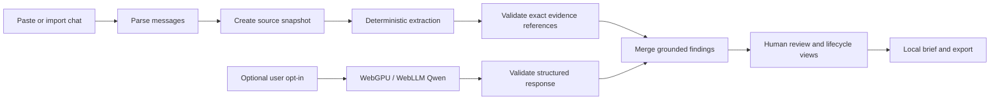

# Unread Radar AI

**Turn a long chat export into an evidence-linked catch-up brief, locally in your browser.**

> **Live demo:** Not configured in this repository.
>
> **Screenshots/GIF:** None are included; no visual evidence is claimed.

## What it does

Unread Radar AI reads pasted or exported text conversations and surfaces candidate tasks, possible owners, timing, lifecycle updates, decisions, and exact source quotations. It is designed to help a person catch up on a conversation while keeping uncertain interpretations visible.

The deterministic rules engine runs by default. Optional Qwen analysis runs on-device through WebLLM only after the user opts in; it requires compatible WebGPU hardware and downloads model weights to browser-managed storage. Neither mode sends chat text to a cloud AI service.

## Why use it

- Inspect the original message behind a finding.
- Keep extraction outcome separate from your review decision and reported conversation status.
- Avoid guessing an owner when assignment is ambiguous.
- Group open tasks by selected chat participant in the catch-up brief.
- Distinguish an explicit past deadline from evidence that work was missed: the brief says **“no completion message found in this chat.”**

## Try it in 30 seconds

```powershell
npm ci
npm run dev
```

Open the local URL printed by Vite, choose **Try English sample** or **Try Hinglish sample**, and run the default rules-only analysis. Sample text is synthetic and included for demonstration; do not paste conversations you are not authorized to analyze.

## Example

Input:

```text
[14:05, 12/10/2024] Alex Johnson: They are in the shared drive. Maria, please update the executive deck with these requests by Friday 5 PM.
[14:06, 12/10/2024] Maria Garcia: Sure, I will update it.
```

Current rules-only output:

| Candidate | Owner | Timing | Conversation status |
|---|---|---|---|
| update the executive deck with these requests by Friday 5 PM | Maria | Friday, 5 PM | Acknowledged |

Evidence shown on the task:

> `[14:05, 12/10/2024] Alex Johnson: They are in the shared drive. Maria, please update the executive deck with these requests by Friday 5 PM.`

This is an illustrative result from a small authored sample, not a claim about real-world accuracy.

## How it works



Rules-only mode does not initialize WebLLM. The optional model can suggest candidates, but deterministic findings remain authoritative and model-provided owners or dates are not accepted without source support.

## Development and checks

Requirements: Node.js 20 or newer and npm.

```powershell
npm ci
npm test
npm run bench:v2
npm run build
npm run dev
```

The current benchmark is a **synthetic regression suite**, authored to catch code regressions. It is not independent evaluation data and does not establish real-world task-extraction accuracy.

### Synthetic regression suite (development split)

| Metric | Strict | Lenient |
|---|---:|---:|
| Task precision | 98.3% (59/60) | 100.0% (66/66) |
| Task recall | 95.2% (59/62) | 100.0% (66/66) |
| Duplicate rate | 0.0% (0/60) | 0.0% (0/66) |

Run `npm run bench:v2` to reproduce these results for the current branch. These numbers measure only the committed synthetic development split. No independent real-world holdout results are claimed.

## Limitations

- The rules engine is conservative and will miss some tasks or leave owners and dates unknown.
- Exact quotation validity proves that text exists at a source location; it does not prove that the interpretation is correct.
- A chat’s silence does not prove a task was missed or completed.
- The catch-up brief only says “assigned” when its owner match and participant identity checks pass; assignment alone does not mean someone is waiting.
- Optional local AI requires compatible WebGPU hardware. Model download/loading/inference can fail; fallback uses rules-only findings and has narrower coverage.
- Inputs are limited to 60,000 characters for interactive analysis. Raw chat text and full source snapshots are not saved by the app; analysis and review data can persist across reloads only when the user opts in.
- No real-world independent labelled evaluation set is included. Real-world accuracy remains unvalidated.

## Privacy and authorization

Conversation parsing and analysis run in the browser. Review the source and verify each interpretation before relying on it. Use only chat exports you are authorized to process. Do not commit private chats or holdout data.

Saving analysis is off by default. When enabled, the app stores up to five analysis records in this browser's `localStorage`: extracted results (including quoted evidence), review decisions and task statuses, selected identity, a source fingerprint, message fingerprints/ranges, and save/schema metadata. It does not store raw chat text or the full source snapshot, and it does not sync data to another device. `localStorage` is not encrypted; data is accessible to this site's scripts and people or software with access to the browser profile. Turning saving off stops new writes but does not delete prior records; use **Clear saved data** to remove all records written by this feature. Clearing is not a guarantee of forensic erasure. Storage failures leave the analysis available in memory.

## Project documentation

- [Catch-up brief behavior and safety rules](docs/catch-up-brief.md)
- [Local AI and analysis modes](docs/local-ai.md)
- [Optional local persistence](docs/persistence.md)
- [Benchmark protocol](docs/benchmark.md)
- [Annotation and independent holdout workflow](benchmark/README.md)
- [Deployment and release checks](docs/deployment.md)

## License

MIT. See [LICENSE](LICENSE).
